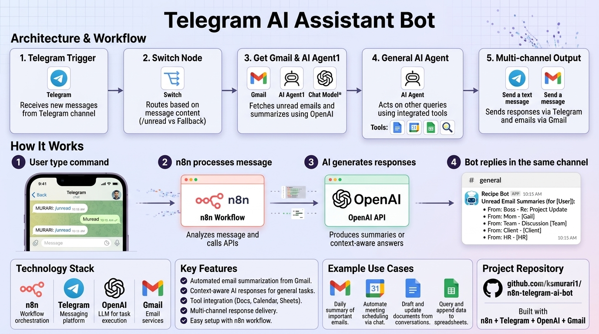
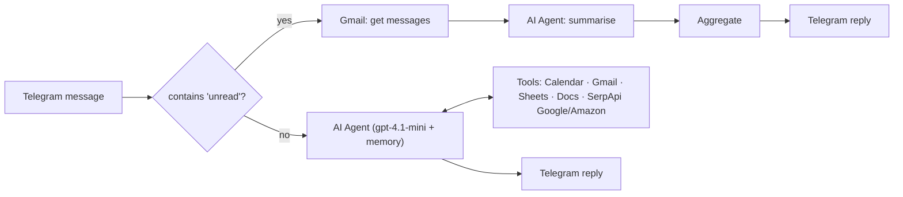

# Telegram AI Assistant Bot (n8n)

> A personal AI assistant in Telegram that books meetings, sends emails, updates Sheets and Docs, and searches the web.

  

## Overview

An **agentic** n8n workflow. Every Telegram message goes to a tool-calling AI agent (`gpt-4.1-mini` with conversation memory) that decides which tool to use: Google Calendar, Gmail, Google Sheets, Google Docs, or SerpApi Google/Amazon search. Messages containing *"unread"* take a second path that fetches your Gmail inbox and replies with a summary.

## Features

- Natural-language control of **Google Calendar, Gmail, Sheets and Docs**
- Web and Amazon product search through **SerpApi**
- Conversation memory (window buffer) for follow-up questions
- Dedicated *unread email summary* route
- Strict ISO 8601 + IST time formatting for calendar events

## Demo



## How it works



## Tech stack

| Layer | Technology |
|---|---|
| Automation | n8n |
| Agent | n8n LangChain Agent + OpenAI `gpt-4.1-mini` |
| Channels | Telegram |
| Tools | Google Calendar, Gmail, Google Sheets, Google Docs, SerpApi |

## Project structure

```text
.
├── Telegram AI Assistant Bot (1).json   # n8n workflow export
└── Gemini_Generated_Image_*.png
```

## Getting started

**Prerequisites:** a running [n8n](https://n8n.io) instance (n8n Cloud or self-hosted), a Telegram bot token from @BotFather

1. Download `Telegram AI Assistant Bot (1).json` from this repository.
2. In n8n, open **Workflows → Import from File** and choose the JSON file.
3. Open each node that needs an account and connect your own credentials (listed below). The export contains no secrets, only credential names.
4. Click **Execute workflow** to test, then **Activate** it.

## Usage

Message your bot, for example:

- *"Schedule a meeting with Ravi tomorrow at 4 pm for 30 minutes"*
- *"Summarise my unread emails"*
- *"Find the best-rated wireless earbuds under 3000 rupees on Amazon"*

## Notes

- Credentials to connect: Telegram, OpenAI, Google Calendar, Gmail, Google Sheets, Google Docs, SerpApi.
- Update the current-date line in the agent's system message, or replace it with `{{ $now }}`.

## License

Released under the [MIT License](LICENSE).

## Author

**Prasanth Sundararajan**, Senior SRE and AI Engineer  
[LinkedIn](https://www.linkedin.com/in/prasanth-s-a093a7109/) · [GitHub](https://github.com/prasanth-sundararajan)
